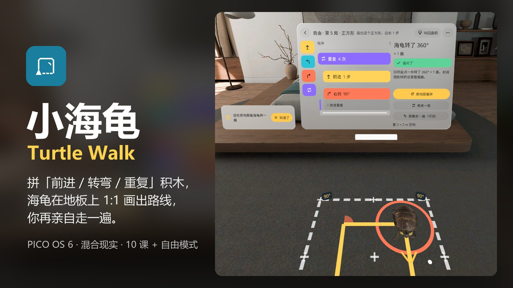
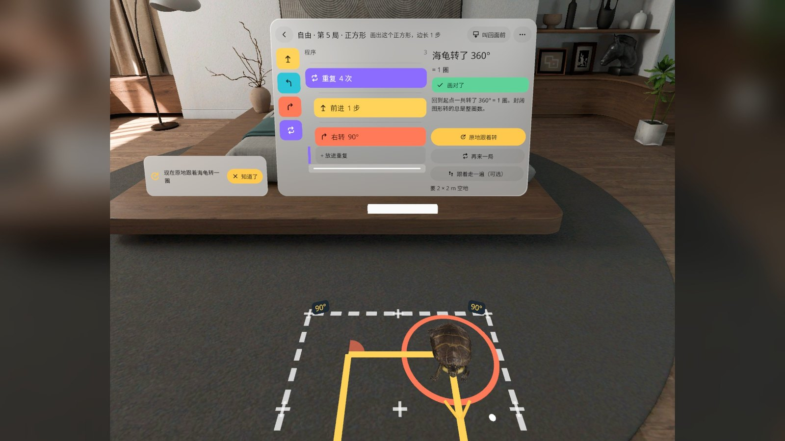
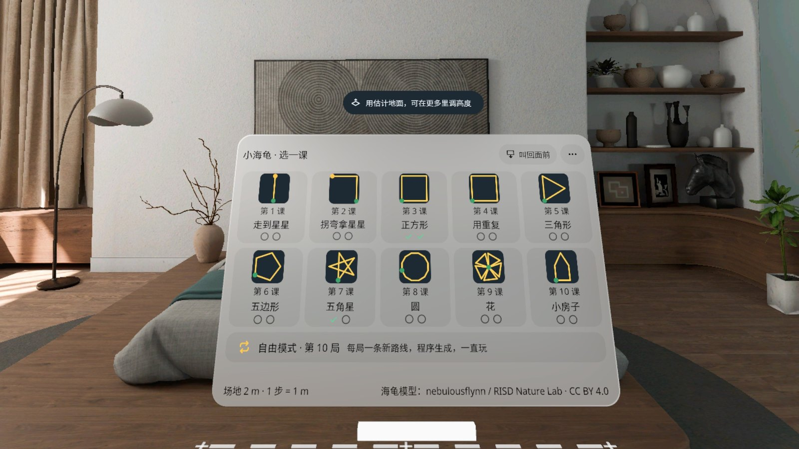
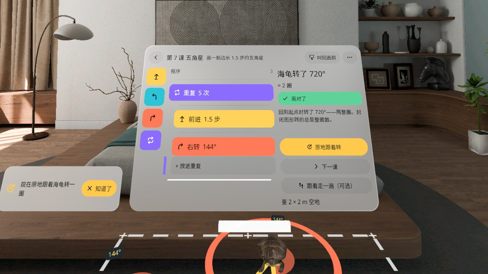
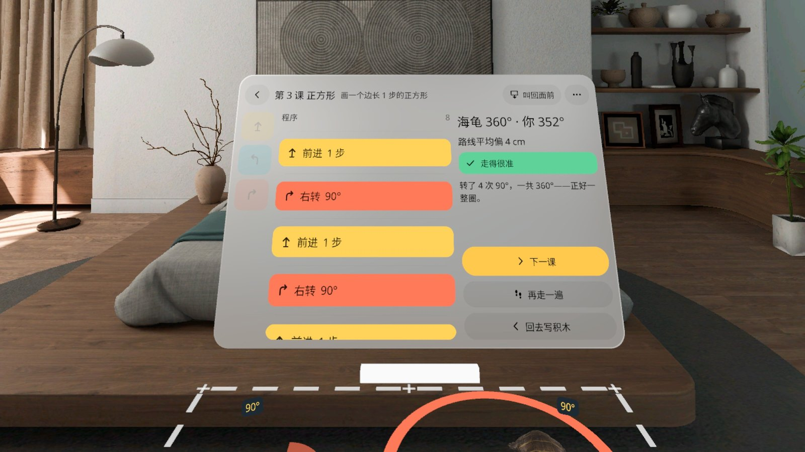
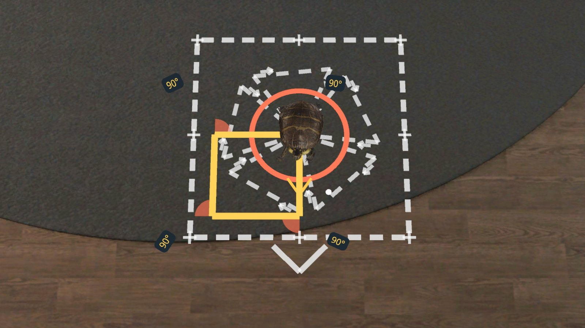
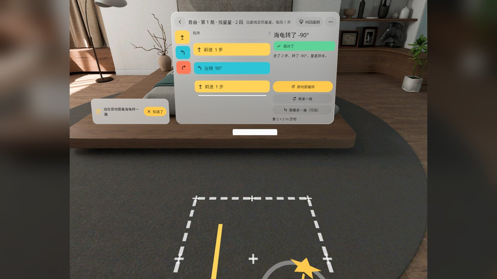

# 小海龟 Turtle Walk



[中文](#中文) · [English](#english)

---

## 中文

**拼「前进 / 转弯 / 重复」积木，海龟在地板上 1:1 画出路线，你再亲自走一遍。** 走完一个封闭图形，你会发现自己正好转了 360°。

小海龟是给孩子的 Logo 海龟编程课，跑在 PICO OS 6 的混合现实里：透视画面里你家的地板就是画布，2 × 2 m 的场地上 1 步 = 1 m。

- **10 节课**：走到星星 → 拐弯拿星星 → 正方形 → 用重复 → 三角形 → 五边形 → 五角星 → 圆 → 花 → 小房子。
- **积木编程**：前进、左转、右转、重复（可以嵌套），在编程台上拼，按「画出来」海龟就沿着程序在地板上画线。
- **转角就是身体感觉**：海龟每到一个拐角会亮出转角度数；「原地跟着转」让你站在原地跟海龟一起转，「跟着走一遍」让你沿着地上的线自己走，应用对比你转的总角度和海龟的。
- **自由模式**（v0.1.3 新增）：课程下面一张卡，每局一条程序生成的新路线（种子 + 5 档难度，每条都先校验能画、在场地内、封闭图形总转角是整圈），「再来一局」一直玩。完全离线。
- **设置**：语言、叫回面板、移动场地、重置进度、关于、退出应用（二次确认）。

### 截图

| | |
|---|---|
|  |  |
| 自由模式第 5 局：重复 4 次「前进 1 步、右转 90°」，海龟在地板上画出正方形，回到起点一共转了 360° | 选一课：10 节课 + 自由模式卡 |
|  |  |
| 第 7 课五角星：重复 5 次「前进 1.5 步、右转 144°」，海龟转了 720°，两整圈 | 自己走一遍以后：海龟 360°、你 352°，走得很准 |
|  |  |
| 俯视：校准后的海龟站在场地中心，橙色转角弧标出每个 90° | 自由模式第 1 局：沿虚线走到星星 |

截图来自 PICO 模拟器（v0.1.3，QA 第 3 轮），用调试输入驱动，**不是真实手势录像**。海报和截图的 16:9 版本是方形截图居中补背景得到的。

### 安装

从 [Release v0.1.3](https://github.com/kejing-dev/TurtleWalk/releases/tag/v0.1.3) 下载 `TurtleWalk-v0.1.3.apk`，然后：

```bash
adb install -r TurtleWalk-v0.1.3.apk
pico-cli app launch io.embodit.turtlewalk
```

需要 PICO OS 6（Spatial SDK 6.1.9），场地要 2 × 2 m 空地。

### 已知问题（v0.1.3）

QA 第 3 轮没有全过，用户决定照样发布（2026-11-02），下一版修：

1. **q3-1 面板放在墙 / 家具后面时点不中**：应用给识别到的平面（墙、柜、床、桌）建了可交互碰撞体，射线先打到墙上；面板在墙前正常。
2. **q3-2 缺面板摆位单测**：低头 30° / 抬头 30° / 歪头 20° 三种头位姿下的面板摆位没有单元测试（模拟器上画面本身是对的）。
3. **q3-3 英文课程卡课名截断**：第 1、2 课显示成「Walk to th…」「Turn to th…」。
4. **q3-4 设置截断**：「关于」行（中英）末尾被截；中文语言分段「跟随系统」末字被裁。
5. **q3-5 自由模式目标说明截断**：部分局的标题行说明被截（如中文「沿虚线走到星星，每段 0.7…」，英文「Follow the dash…」）。

### 版本历史

- **v0.1.3**（2026-10-30）：用户真机反馈「乌龟做大一点、放在中心，朝向和中心不对；加个一直能玩的自由模式」→ 海龟模型加校准节点（加载后量包围盒，底面中心归原点、头朝前、龟身 0.35 m，转身绕自身中心）；课程下新增自由模式；设置里加重置进度 / 关于 / 退出应用。
- **v0.1.2**（2026-10-28）：内容朝向用户（四方向测试）；场地放好就锁定，菜单「移动场地」再动；编程台世界固定、可拖动、可叫回面前；换成写实海龟模型（CC BY 4.0）。
- **v0.1.1**（2026-10-28）：修「先转转看」后再显示墨线的崩溃；QA 第 1 轮小项。
- **v0.1.0**（2026-10-27）：第一版，10 节课。

### 技术

Kotlin，PICO Spatial SDK 6.1.9，一个混合现实 Stage（Full Space，透视），包名 `io.embodit.turtlewalk`。开发约定和结构见 [AGENTS.md](AGENTS.md)。

### 素材和许可

海龟模型「Turtle By RISD Naturelab - optimised」，作者 nebulousflynn（RISD Nature Lab 扫描），CC BY 4.0；字体 Noto Sans / Noto Sans SC，SIL OFL 1.1。详见 [ASSETS.md](ASSETS.md)。模型文件不在 git 里，重新构建前按 ASSETS.md 下载导出。

---

## English

**Snap "forward / turn / repeat" blocks together, watch a turtle draw the route 1:1 on your floor, then walk it yourself.** Finish a closed shape and you find you turned exactly 360°.

Turtle Walk is Logo-turtle coding for kids in PICO OS 6 mixed reality: your own floor (in passthrough) is the canvas, a 2 × 2 m field where 1 step = 1 m.

- **10 lessons**: walk to the star → turn to the star → square → use repeat → triangle → pentagon → five-point star → circle → flower → little house.
- **Block coding**: forward, turn left, turn right and repeat (nestable) on a code panel; press "Draw it" and the turtle runs the program and draws on the floor.
- **Turns you feel in your body**: the turtle shows the angle at every corner; "Turn along" has you turn on the spot with it, "Walk it" has you walk the line yourself, and the app compares your total turn with the turtle's.
- **Free mode** (new in v0.1.3): a card under the lessons; each round is a new generated route (seed + 5 difficulty tiers, every route checked to be drawable, inside the field, and a whole number of turns for closed shapes); "Next round" forever. Fully offline.
- **Settings**: language, bring panel here, move field, reset progress, about, quit app (with confirmation).

### Screenshots

See the table above (Chinese UI): free-mode square, lesson list, lesson 7 star (720°), walk-it result (turtle 360° / you 352°), top view of the calibrated turtle, free-mode "find the star".

Screenshots are from the PICO emulator (v0.1.3, QA round 3), driven by debug input — **not a recording of real hand gestures**. The 16:9 versions are square captures centred on a filled background.

### Install

Download `TurtleWalk-v0.1.3.apk` from [Release v0.1.3](https://github.com/kejing-dev/TurtleWalk/releases/tag/v0.1.3), then:

```bash
adb install -r TurtleWalk-v0.1.3.apk
pico-cli app launch io.embodit.turtlewalk
```

Requires PICO OS 6 (Spatial SDK 6.1.9) and 2 × 2 m of free floor.

### Known issues (v0.1.3)

QA round 3 did not fully pass; the owner chose to release anyway (2026-11-02). To be fixed next version:

1. **q3-1 Panel cannot be clicked behind a wall or furniture**: the app builds interactive colliders for detected planes (walls, cabinets, beds, tables), so the ray hits the wall first. Works in front of the wall.
2. **q3-2 No unit test for panel placement** at head pitch −30° / +30° / roll 20° (the result looks right on the emulator).
3. **q3-3 English lesson cards truncate** the names of lessons 1 and 2 ("Walk to th…", "Turn to th…").
4. **q3-4 Settings truncation**: the About row (both languages) is cut; the Chinese "Follow system" segment loses its last character.
5. **q3-5 Free-mode goal text truncates** on some rounds ("Follow the dash…").

### Version history

- **v0.1.3** (2026-10-30): headset feedback "make the turtle bigger and centred, facing and centre are off; add a free mode you can always play" → turtle calibration node (measured bounds, bottom centre at origin, head forward, 0.35 m long, turns about its own centre); free mode; settings with reset progress / about / quit.
- **v0.1.2** (2026-10-28): content faces the user; field locks once placed ("Move field" in the menu); world-fixed draggable code panel with "bring here"; realistic turtle model (CC BY 4.0).
- **v0.1.1** (2026-10-28): fix crash when showing ink after "turn first"; QA round 1 small items.
- **v0.1.0** (2026-10-27): first version, 10 lessons.

### Tech, assets, license

Kotlin, PICO Spatial SDK 6.1.9, one Mixed Stage (Full Space, passthrough), package `io.embodit.turtlewalk`; see [AGENTS.md](AGENTS.md). Turtle model "Turtle By RISD Naturelab - optimised" by nebulousflynn (RISD Nature Lab scan), CC BY 4.0; fonts Noto Sans / Noto Sans SC, SIL OFL 1.1 — see [ASSETS.md](ASSETS.md). Model files are not in git; download and export them per ASSETS.md before building.
